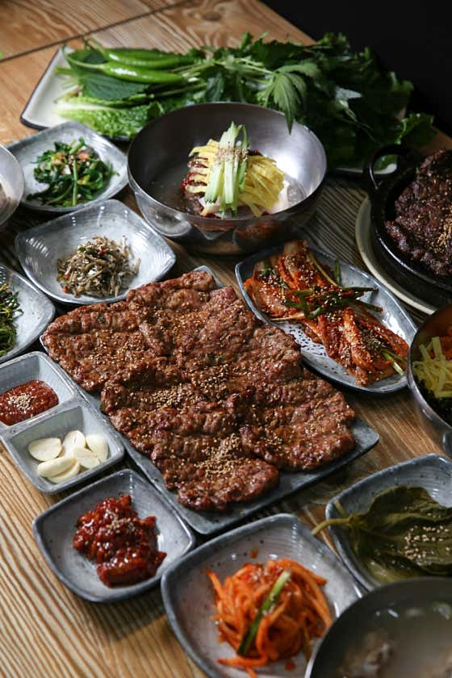
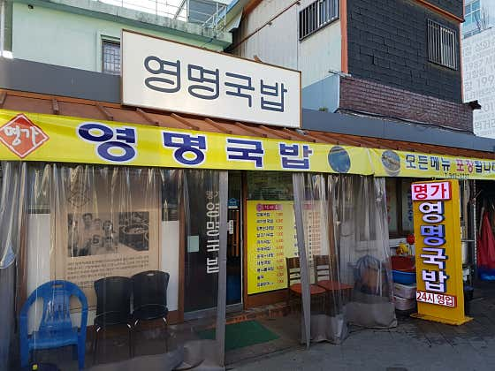
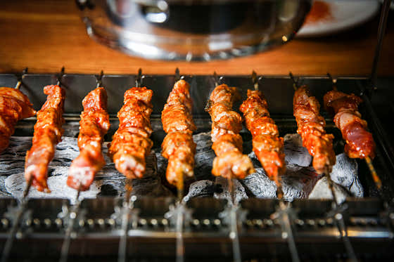
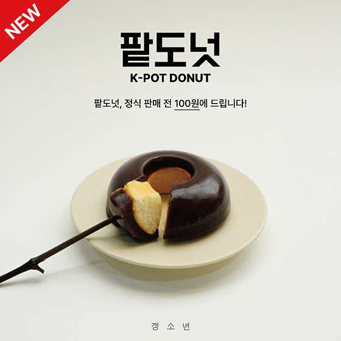
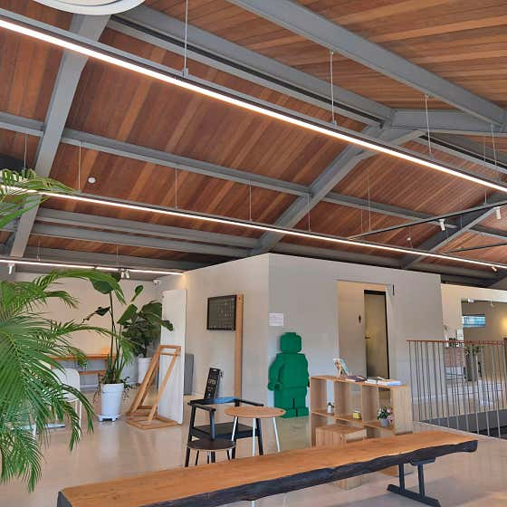
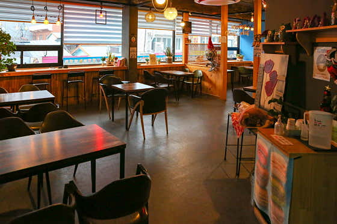

# 광주송정역 근처 맛집 & 카페 추천

> 조사일: 2026-11-12 · 출처: 네이버 플레이스 검색 결과(별점·리뷰 수는 조사 시점 기준)
> 이미지는 네이버 플레이스 업체 사진을 `images/` 폴더에 받아둔 거예요. 같은 이름으로 파일만 바꾸면 사진이 교체됩니다.

---

## 🍽️ 음식점

### 1. 빛고을떡갈비 광주송정본점

- **분류**: 떡갈비(육류·고기요리)
- **주소**: 광주 광산구 광산로29번길 14 1층
- **별점/리뷰**: ★4.78 · 리뷰 7,215개
- **대표 메뉴**: 한우숯불떡갈비 26,000원 / 돼지숯불떡갈비 17,000원 / 육회비빔밥

**추천 이유**
송정리 하면 떡갈비죠. 이 집은 리뷰가 7천 개가 넘을 만큼 검증된 곳이고, 기본으로 나오는 맑은 등뼈국(리필 가능)이 특히 칭찬을 많이 받아요. 떡갈비에 육회비빔밥을 곁들이는 조합이 인기이고, 행정안전부 '착한가격업소'로도 선정됐어요.

**키워드**: `#송정리떡갈비` `#육회비빔밥` `#착한가격업소`

---

### 2. 영명국밥해장국

- **분류**: 국밥·해장국
- **주소**: 광주 광산구 송정로8번길 5 (송정역 2번 출구 도보 약 2분)
- **별점/리뷰**: ★4.34 · 리뷰 4,167개
- **대표 메뉴**: 살코기국밥 10,000원 / 모듬국밥 11,000원 / 새끼보국밥 11,000원

**추천 이유**
송정역시장 바로 앞이라 기차 타기 전후로 들르기 딱 좋아요. 양이 많고 잡내가 적다는 평이 많고, 쫄깃한 암뽕순대가 들어간 국밥이 대표예요. 새벽 2시 30분까지 영업해서 늦은 시간에도 갈 수 있고, '수요미식회'에도 소개됐어요.

**키워드**: `#암뽕순대국밥` `#혼밥가능` `#늦게까지영업`

---

### 3. 장백산양꼬치 송정본점

- **분류**: 중식당·양꼬치
- **주소**: 광주 광산구 송정로1번길 20
- **별점/리뷰**: ★4.71 · 리뷰 860개
- **대표 메뉴**: 양꼬치구이(10개) 16,000원 / 양갈비살꼬치 / 옥수수온면

**추천 이유**
"광주 송정역 대표 양꼬치 맛집"으로 꼽히는 곳이에요. 숯불에 굽는 양꼬치가 잡내 없이 깔끔하다는 후기가 많고, 향신료가 세지 않은 옥수수온면도 인기 메뉴예요. 저녁 모임이나 술 한잔하기 좋은 분위기예요.

**키워드**: `#숯불양꼬치` `#옥수수온면` `#저녁모임`

---

## ☕ 카페

### 1. 갱소년

- **분류**: 카페·디저트(수제 양갱)
- **주소**: 광주 광산구 송정로8번길 7-4 1층
- **별점/리뷰**: ★4.77 · 리뷰 2,803개
- **대표 메뉴**: 팥도넛 3,800원 / 팥두유 슈페너 6,500원 / 무등산 양갱 상자 8pcs 30,000원

**추천 이유**
무채색 감성 인테리어의 수제 양갱 전문 카페예요. 디저트가 많이 달지 않아서 좋다는 평이 많고, 직접 내려주는 드립커피도 맛있다고 해요. 양갱 세트는 포장이 예뻐서 광주 기념품·선물용으로 딱이에요.

**키워드**: `#수제양갱` `#감성카페` `#선물추천`

---

### 2. 프로머스 (FROMUS)

- **분류**: 카페·디저트(대형 카페)
- **주소**: 광주 광산구 도산로9번길 43 (도산동, 송정역 근처)
- **별점/리뷰**: ★4.95 · 리뷰 2,234개
- **대표 메뉴**: 어스커피(only ice) 6,500원 / 어스레이디(only ice) 6,500원 / 아메리카노 4,000원

**추천 이유**
별점 4.95로 이번 후보 중 평이 가장 좋은 커피 전문 카페예요. 원목 가구를 만드는 사장님이 직접 꾸민 넓은 공간이라 분위기가 좋고, 가구도 살 수 있어요. 시그니처 크림라떼 '어스커피'가 특히 인기예요. 주차가 편하고 21시까지 주문할 수 있어요.

**키워드**: `#대형카페` `#원목감성` `#크림라떼`

---

### 3. 청자다방 송정역점

- **분류**: 카페·디저트
- **주소**: 광주 광산구 광산로 5 (광주송정역 1번 출구에서 약 137m, 1913송정역시장 맞은편)
- **별점/리뷰**: 리뷰 554개 (별점 정보 없음)
- **대표 메뉴**: 리얼군고구마라떼 / 흑당라떼 / 인절미 빙수

**추천 이유**
송정역에서 걸어서 2분 정도라 기차 시간을 기다리며 들르기 제일 편해요. 아메리카노가 1천 원대로 저렴하고, 군고구마라떼와 흑당라떼가 대표 메뉴예요. 23시까지 영업해서 늦은 기차 시간에도 이용할 수 있어요.

**키워드**: `#역앞카페` `#군고구마라떼` `#가성비`

---

## 📍 한눈에 보기

| 구분 | 가게 | 별점(리뷰) | 키워드 |
|---|---|---|---|
| 음식점 | 빛고을떡갈비 광주송정본점 | 4.78 (7,215) | 송정리떡갈비 · 육회비빔밥 · 착한가격업소 |
| 음식점 | 영명국밥해장국 | 4.34 (4,167) | 암뽕순대국밥 · 혼밥가능 · 늦게까지영업 |
| 음식점 | 장백산양꼬치 송정본점 | 4.71 (860) | 숯불양꼬치 · 옥수수온면 · 저녁모임 |
| 카페 | 갱소년 | 4.77 (2,803) | 수제양갱 · 감성카페 · 선물추천 |
| 카페 | 프로머스 | 4.95 (2,234) | 대형카페 · 원목감성 · 크림라떼 |
| 카페 | 청자다방 송정역점 | - (554) | 역앞카페 · 군고구마라떼 · 가성비 |

> ※ 영업시간·가격은 바뀔 수 있으니 방문 전 네이버 지도에서 한 번 더 확인해 주세요.
