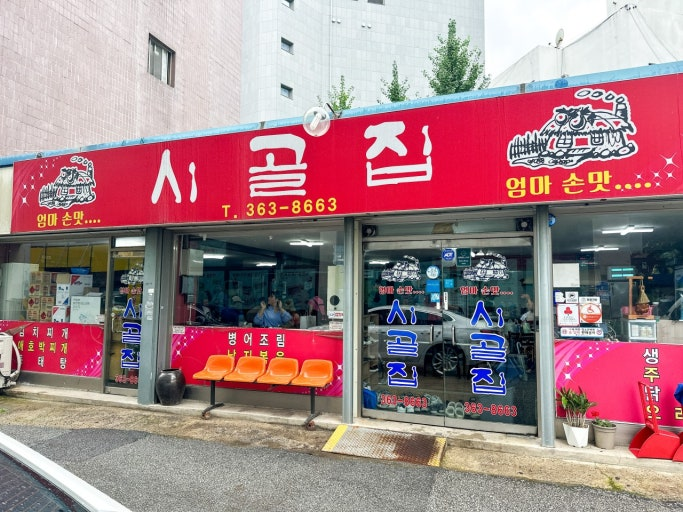
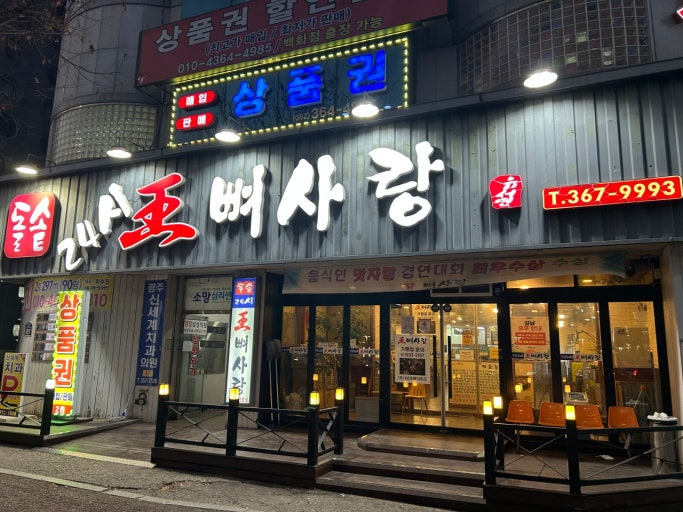
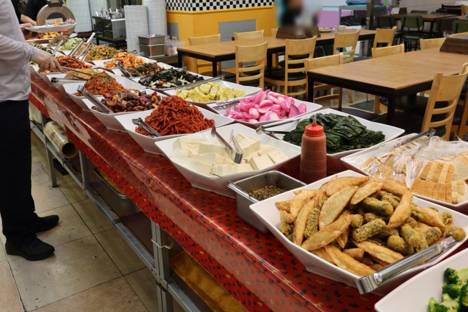
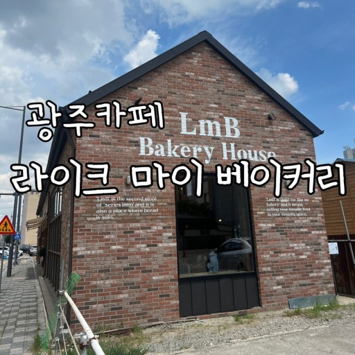
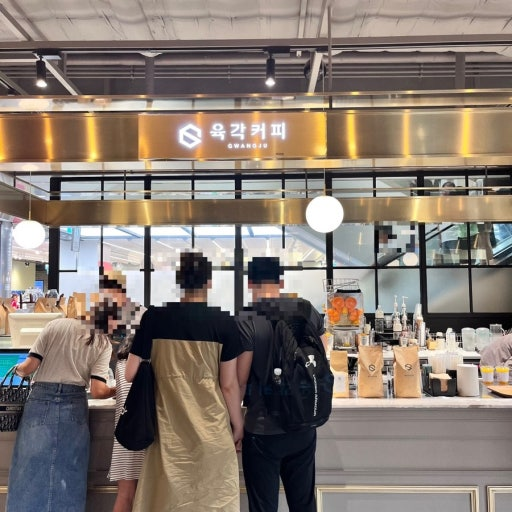
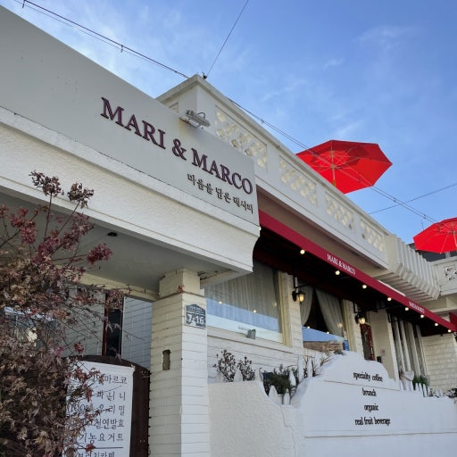

# 광주종합버스터미널(유스퀘어) 근처 맛집 & 카페 추천

> 조사일: 2026-11-12 · 출처: 다이닝코드 검색 결과(점수·평점·평가 인원·주소·지도 좌표는 조사 시점 기준), 네이버 블로그 후기
> 사진은 네이버 블로그 후기 사진을 `images/` 폴더에 받아둔 거예요. 사진 아래에 출처를 적었고, 저작권은 각 블로거에게 있습니다. 같은 이름으로 파일만 바꾸면 사진이 교체됩니다.

## 목차

- 🍽️ 음식점 3곳 · ☕ 카페 3곳

---

# 광주종합버스터미널(유스퀘어)

> 광주 서구 무진대로 904 유스퀘어 터미널에서 **직선거리 1km 안**에 있는 맛집·카페예요. 버스 타기 전후로 들르기 좋은 곳 위주로 골랐어요. 카페는 커피와 음료가 중심인 곳만 넣었어요.

## 🍽️ 음식점

### 1. 시골집

*📷 사진 출처: 네이버 블로그 [져니콩의 애정블로그](https://blog.naver.com/jiwon4348/223191129343)*

- **분류**: 한식(김치찌개)
- **주소**: 광주 서구 내방로398번길 4 (터미널에서 직선 약 500m)
- **별점/리뷰**: 다이닝코드 77점 · ★4.7 (12명)
- **대표 메뉴**: 김치찌개 / 김치주물럭

**추천 이유**
이번 후보 중 다이닝코드 점수가 가장 높은 곳이에요. 김치찌개와 김치주물럭이 대표 메뉴이고, 블로그 후기에도 "유스퀘어 광주터미널에서 멀지 않다"고 나와서 버스 타기 전에 한 끼 하기 좋아요.

**키워드**: `#김치찌개` `#김치주물럭` `#터미널근처`

---

### 2. 왕뼈사랑 유스퀘어

*📷 사진 출처: 네이버 블로그 [방구링](https://blog.naver.com/y____ziin/224255911419)*

- **분류**: 뼈해장국
- **주소**: 광주 서구 무진대로 937 (터미널에서 직선 약 310m)
- **별점/리뷰**: 다이닝코드 75점 · ★4.4 (40명)
- **대표 메뉴**: 뼈해장국

**추천 이유**
평가 인원이 40명으로 세 곳 중 가장 많아요. 네이버 블로그에 "광주터미널 근처 혼밥" 후기가 여러 개 있어서 혼자 들르기 편하고, 24시간 영업이라는 후기도 있어 늦은 시간에도 갈 수 있어요.

**키워드**: `#뼈해장국` `#혼밥가능` `#24시간후기`

---

### 3. 월드밥

*📷 사진 출처: 네이버 블로그 [순간순간 ❛ ֊ ❛](https://blog.naver.com/kangminseon/224453501889)*

- **분류**: 한식뷔페
- **주소**: 광주 서구 군분2로 54 금호월드 지하 1층 (터미널에서 직선 약 360m)
- **별점/리뷰**: 다이닝코드 74점 · ★4.9 (11명)
- **대표 메뉴**: 한식뷔페

**추천 이유**
평점 4.9로 세 곳 중 평이 가장 좋은 한식뷔페예요. '생생정보통'에 소개됐고, 네이버 블로그에도 "터미널 맛집" 후기가 있어요. 여러 반찬을 골라 먹을 수 있어서 든든하게 먹고 출발하기 좋아요.

**키워드**: `#한식뷔페` `#생생정보통` `#금호월드`

---

## ☕ 카페

### 1. 라이크 마이 베이커리 유스퀘어

*📷 사진 출처: 네이버 블로그 [일상 취미 정보 기록](https://blog.naver.com/gkssk0021/223195412835)*

- **분류**: 베이커리카페
- **주소**: 광주 서구 무진대로 921 (터미널에서 직선 약 240m)
- **별점/리뷰**: 다이닝코드 74점 · ★4.1 (14명)
- **대표 메뉴**: 정보 없음

**추천 이유**
세 곳 중 다이닝코드 점수가 가장 높고 터미널에서도 가장 가까워요. 네이버 블로그에 "광주 버스터미널 근처 대형카페", "버스 기다리는 동안 머무르기 좋다"는 후기가 여러 개 있어요. '반려동물동반' 태그도 붙어 있어요.

**키워드**: `#대형카페` `#버스대기` `#반려동물동반`

---

### 2. 육각커피 신세계백화점광주점

*📷 사진 출처: 네이버 블로그 [우니의 카페, 맛집 추천](https://blog.naver.com/woonnnny/223175342672)*

- **분류**: 커피
- **주소**: 광주 서구 무진대로 932 신세계백화점 (터미널에서 직선 약 260m)
- **별점/리뷰**: 다이닝코드 68점 · ★4.3 (5명)
- **대표 메뉴**: 정보 없음

**추천 이유**
터미널 바로 옆 신세계백화점 안에 있어서 들르기 쉬워요. 리뷰에 광주 지역 체인이라고 나와요. 다만 평가 인원이 5명으로 적어요.

**키워드**: `#신세계백화점` `#광주체인` `#터미널옆`

---

### 3. 마리앤마르코

*📷 사진 출처: 네이버 블로그 [휘뚜루마뚜루 당](https://blog.naver.com/happy_geevely/222643444925)*

- **분류**: 브런치카페
- **주소**: 광주 서구 내방로338번길 7-16 (터미널에서 직선 약 480m)
- **별점/리뷰**: 다이닝코드 66점 · ★4.4 (7명)
- **대표 메뉴**: 정보 없음

**추천 이유**
'예쁜', '테라스' 태그가 붙은 브런치카페예요. 분위기 좋은 곳에서 여유 있게 쉬고 싶을 때 좋아요. 다만 평가 인원이 7명으로 적어요.

**키워드**: `#브런치카페` `#테라스` `#분위기`

---

> ※ 거리는 지도 좌표로 잰 직선거리라 실제 걷는 거리는 더 길어요. 영업시간·가격은 확인하지 않았으니 방문 전 네이버 지도에서 한 번 더 확인해 주세요.
